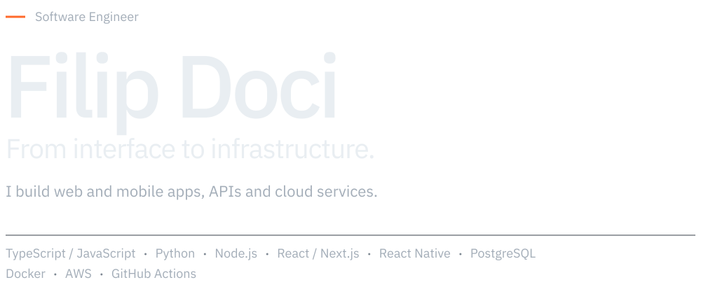

<!-- Generated by the profile engine (npm run build). Edit profile.config.ts, not this file. -->

<picture><source media="(max-width: 767.98px)" srcset="assets/spacer.svg"><source media="(prefers-color-scheme: light)" srcset="assets/hero.wide.light.svg"><source media="(prefers-color-scheme: dark)" srcset="assets/hero.wide.dark.svg"></picture><picture><source media="(min-width: 768px)" srcset="assets/spacer.svg"><source media="(prefers-color-scheme: light)" srcset="assets/hero.compact.light.svg"><source media="(prefers-color-scheme: dark)" srcset="assets/hero.compact.dark.svg"></picture>

<picture><source media="(max-width: 767.98px)" srcset="assets/spacer.svg"><source media="(prefers-color-scheme: light)" srcset="assets/introduction.wide.light.svg"><source media="(prefers-color-scheme: dark)" srcset="assets/introduction.wide.dark.svg"></picture><picture><source media="(min-width: 768px)" srcset="assets/spacer.svg"><source media="(prefers-color-scheme: light)" srcset="assets/introduction.compact.light.svg"><source media="(prefers-color-scheme: dark)" srcset="assets/introduction.compact.dark.svg"></picture>

<picture><source media="(max-width: 767.98px)" srcset="assets/spacer.svg"><source media="(prefers-color-scheme: light)" srcset="assets/expertise.wide.light.svg"><source media="(prefers-color-scheme: dark)" srcset="assets/expertise.wide.dark.svg"></picture><picture><source media="(min-width: 768px)" srcset="assets/spacer.svg"><source media="(prefers-color-scheme: light)" srcset="assets/expertise.compact.light.svg"><source media="(prefers-color-scheme: dark)" srcset="assets/expertise.compact.dark.svg"></picture>

<picture><source media="(max-width: 767.98px)" srcset="assets/spacer.svg"><source media="(prefers-color-scheme: light)" srcset="assets/ecosystem.wide.light.svg"><source media="(prefers-color-scheme: dark)" srcset="assets/ecosystem.wide.dark.svg"></picture><picture><source media="(min-width: 768px)" srcset="assets/spacer.svg"><source media="(prefers-color-scheme: light)" srcset="assets/ecosystem.compact.light.svg"><source media="(prefers-color-scheme: dark)" srcset="assets/ecosystem.compact.dark.svg"></picture>

<picture><source media="(max-width: 767.98px)" srcset="assets/spacer.svg"><source media="(prefers-color-scheme: light)" srcset="assets/activity.wide.light.svg"><source media="(prefers-color-scheme: dark)" srcset="assets/activity.wide.dark.svg"></picture><picture><source media="(min-width: 768px)" srcset="assets/spacer.svg"><source media="(prefers-color-scheme: light)" srcset="assets/activity.compact.light.svg"><source media="(prefers-color-scheme: dark)" srcset="assets/activity.compact.dark.svg"></picture>

<a href="https://github.com/DociPRO1"><picture><source media="(max-width: 767.98px)" srcset="assets/spacer.svg"><source media="(prefers-color-scheme: light)" srcset="assets/connect.wide.light.svg"><source media="(prefers-color-scheme: dark)" srcset="assets/connect.wide.dark.svg"></picture><picture><source media="(min-width: 768px)" srcset="assets/spacer.svg"><source media="(prefers-color-scheme: light)" srcset="assets/connect.compact.light.svg"><source media="(prefers-color-scheme: dark)" srcset="assets/connect.compact.dark.svg"></picture></a>

<a href="https://github.com/DociPRO1"><code>github.com/DociPRO1</code></a>

Every visual on this page is generated from source in this repository and rebuilt daily by GitHub Actions.

<!-- Filip Doci, Software Engineer. Software systems, engineered from silicon to screen. I design and build software systems across the full depth of the stack, from firmware on microcontrollers, through device fleets and distributed services, to the cloud infrastructure and interfaces that operate them. -->
