<!-- Generated by the profile engine (npm run build). Edit profile.config.ts, not this file. -->

<picture><source media="(max-width: 767.98px)" srcset="assets/spacer.svg"><source media="(prefers-color-scheme: light)" srcset="assets/hero.wide.light.svg"><source media="(prefers-color-scheme: dark)" srcset="assets/hero.wide.dark.svg"></picture><picture><source media="(min-width: 768px)" srcset="assets/spacer.svg"><source media="(prefers-color-scheme: light)" srcset="assets/hero.compact.light.svg"><source media="(prefers-color-scheme: dark)" srcset="assets/hero.compact.dark.svg"></picture>

<picture><source media="(max-width: 767.98px)" srcset="assets/spacer.svg"><source media="(prefers-color-scheme: light)" srcset="assets/expertise.wide.light.svg"><source media="(prefers-color-scheme: dark)" srcset="assets/expertise.wide.dark.svg"></picture><picture><source media="(min-width: 768px)" srcset="assets/spacer.svg"><source media="(prefers-color-scheme: light)" srcset="assets/expertise.compact.light.svg"><source media="(prefers-color-scheme: dark)" srcset="assets/expertise.compact.dark.svg"></picture>

<picture><source media="(max-width: 767.98px)" srcset="assets/spacer.svg"><source media="(prefers-color-scheme: light)" srcset="assets/ecosystem.wide.light.svg"><source media="(prefers-color-scheme: dark)" srcset="assets/ecosystem.wide.dark.svg"></picture><picture><source media="(min-width: 768px)" srcset="assets/spacer.svg"><source media="(prefers-color-scheme: light)" srcset="assets/ecosystem.compact.light.svg"><source media="(prefers-color-scheme: dark)" srcset="assets/ecosystem.compact.dark.svg"></picture>

<picture><source media="(max-width: 767.98px)" srcset="assets/spacer.svg"><source media="(prefers-color-scheme: light)" srcset="assets/activity.wide.light.svg"><source media="(prefers-color-scheme: dark)" srcset="assets/activity.wide.dark.svg"></picture><picture><source media="(min-width: 768px)" srcset="assets/spacer.svg"><source media="(prefers-color-scheme: light)" srcset="assets/activity.compact.light.svg"><source media="(prefers-color-scheme: dark)" srcset="assets/activity.compact.dark.svg"></picture>

<a href="https://github.com/DociPRO1"><picture><source media="(max-width: 767.98px)" srcset="assets/spacer.svg"><source media="(prefers-color-scheme: light)" srcset="assets/connect.wide.light.svg"><source media="(prefers-color-scheme: dark)" srcset="assets/connect.wide.dark.svg"></picture><picture><source media="(min-width: 768px)" srcset="assets/spacer.svg"><source media="(prefers-color-scheme: light)" srcset="assets/connect.compact.light.svg"><source media="(prefers-color-scheme: dark)" srcset="assets/connect.compact.dark.svg"></picture></a>

<a href="https://github.com/DociPRO1">github.com/DociPRO1</a>

<!-- Filip Doci Software Engineer From interface to infrastructure. I build web and mobile apps, APIs and cloud services. -->
